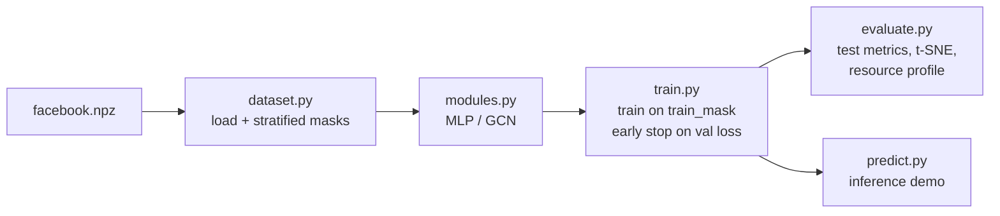
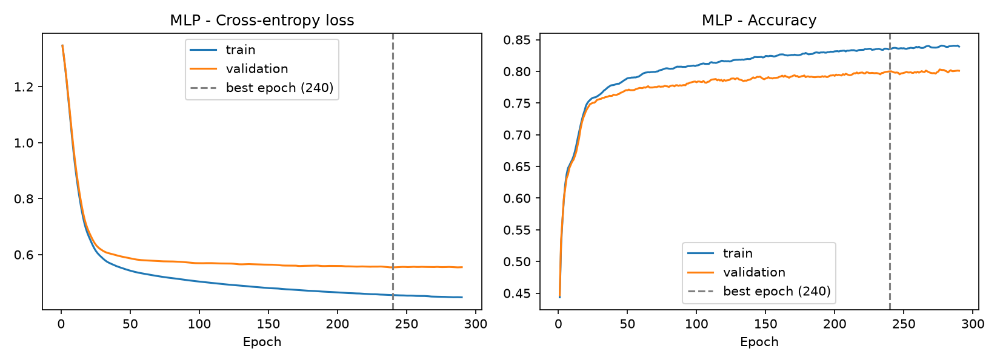
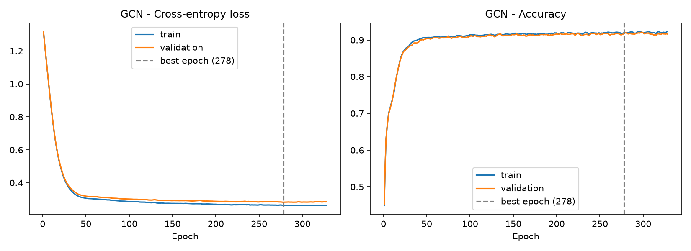
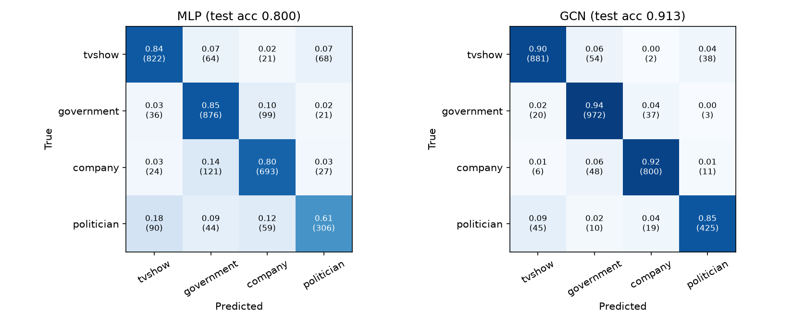
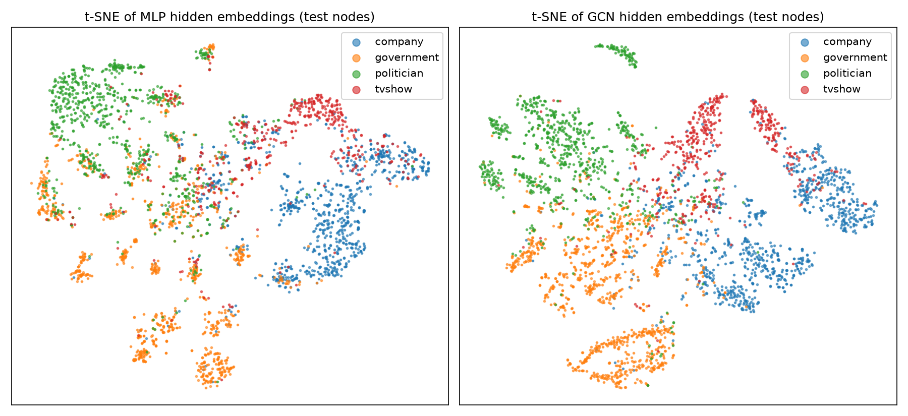

# Multi-layer GNN for Facebook Page-Page Node Classification

**Author:** Aditya Rao (s4810234) · **Course:** COMP3710 Pattern Recognition, UQ 2026
**Project:** 2.1 Classification · Multi-layer GNN · Normal difficulty

---

## Contents
1. [Problem](#1-problem)
2. [How the algorithm works](#2-how-the-algorithm-works)
3. [Feasibility review](#3-feasibility-review)
4. [Dataset, pre-processing and splits](#4-dataset-pre-processing-and-splits)
5. [Usage and reproducibility](#5-usage-and-reproducibility)
6. [Results](#6-results)
7. [The open dilemma: confidence and triage](#7-the-open-dilemma-confidence-and-triage)
8. [Failure case autopsy](#8-failure-case-autopsy)
9. [Recommendation to the project manager](#9-recommendation-to-the-project-manager)
10. [Artificial Intelligence Usage Disclosure](#10-artificial-intelligence-usage-disclosure)
11. [References](#11-references)

---

## 1. Problem

The Facebook Large Page-Page Network [1] is a graph of 22,470 verified Facebook pages (nodes) connected by
171,002 mutual "likes" (edges). Each page belongs to one of four categories defined by Facebook:
**TV show, government organisation, company, or politician**, and is described by a 128-dimensional feature
vector derived from the text the page owner wrote about the page.

The task is **semi-supervised multi-class node classification**: given the graph and the labels of a subset of
pages, predict the category of the remaining pages. The motivating use case is a content-analytics team that
wants to auto-categorise pages and route uncertain cases to human reviewers, so the project evaluates not only
how accurate the model is, but whether its confidence can be trusted (Section 7).

## 2. How the algorithm works

I compare two models with **identical size (8,516 parameters each)** on the **identical data split**:

- **MLP baseline:** a two-layer neural network that sees only each page's own 128 features and ignores the graph.
- **Graph Convolutional Network (GCN)** [2]: a two-layer GNN. In each layer, every page aggregates the
  features of itself and its neighbours, weighted by symmetric degree normalisation, and then applies a
  learned linear transform:

  $$h_i^{(l+1)} = \sigma\Big(\sum_{j \in \mathcal{N}(i) \cup \{i\}} \frac{1}{\sqrt{\hat d_i \hat d_j}}\, W^{(l)} h_j^{(l)}\Big)$$

  where $\hat d_i$ is the degree of node $i$ including its self-loop. The normalisation keeps aggregated
  features on a comparable scale for every node and stops high-degree "hub" pages dominating their
  neighbours. Two layers give each page a receptive field of two hops (friends-of-friends); deeper stacks
  risk **over-smoothing**, where all node embeddings converge to similar values.

**Why a GNN should help:** the graph is strongly **homophilous**. 88.5% of edges connect two pages of the
same category (measured in `dataset.py`), so a page's neighbourhood is strong evidence for its own label.
Because both models have the same parameter count, any improvement of the GCN over the MLP can be attributed
to using the graph structure rather than to extra model capacity.



## 3. Feasibility review

*This is the one-page review presented at the compulsory check-off on 29 October 2026. The numbers in
Section 3 of the review came from an early Colab smoke test with a simple random split; the final pipeline
uses a stratified split (Section 4), so final results differ slightly.*

**1. User need, scope and acceptance criteria.**
User: a content-analytics/moderation team that auto-categorises Facebook pages and routes uncertain cases to
human reviewers. The prototype tests the Confidence & Ambiguity Dilemma: can the GNN's confidence be trusted to
automate easy cases? Acceptance criteria:
1. GNN test accuracy ≥ 0.90 and macro-F1 ≥ 0.88.
2. GNN beats the MLP baseline by ≥ 5 macro-F1 points on the identical split.
3. Calibration: ECE ≤ 0.05 after temperature scaling on validation, shown via a reliability diagram.
4. Reject option: routing ≤ 15% of nodes to review gives ≥ 0.97 accuracy on auto-handled nodes.
5. Resources: training < 5 min, peak VRAM < 2 GB, full-graph inference < 1 s on a single GPU.

**2. Model choice and course concepts.**
2–3 layer GCN (optionally GAT) vs a 2-layer MLP baseline that ignores graph structure. The graph is
homophilous, so message passing adds neighbourhood context that features alone miss; shallow depth avoids
over-smoothing. Transductive semi-supervised setting: all features and edges visible, loss on training labels
only, validation/test labels masked. Evaluation: per-class precision/recall, macro-F1, AUROC, t-SNE, ECE,
coverage-vs-accuracy, VRAM/params/latency.

**3. Preliminary feasibility evidence (data audit + baseline smoke test).**

| Item | Result |
|---|---|
| Nodes / edges | 22,470 / 171,002 undirected (342,004 directed) |
| Feature dim / classes | 128 / 4 |
| Class counts | TV show 6,495 · Govt 6,880 · Company 5,768 · Politician 3,327 |
| Split (seed 42) | 70/15/15 random node split |
| MLP baseline val acc | 0.781 (100 epochs) |
| MLP params / train time | 8,516 / 5.5 s on CPU |

**4. Risks, budget and fallback.**
Over-smoothing/overfitting → shallow depth, dropout, weight decay, early stopping. Class imbalance → macro-F1
and per-class recall. Overconfident GNN → temperature scaling, ECE, reject threshold. Label leakage → strict
masks with assertions. Budget < 2 GPU-hours. Fallback: GCN if GAT is unstable; CPU if no GPU.

## 4. Dataset, pre-processing and splits

**Source:** the modified Gayanku `facebook.npz` [3] (the original PyG download link is no longer available).
It contains `X` (22,470 × 128 float features, SVD-compressed from 4,714 description tokens), `edges_x` /
`edges_y` (342,004 directed edges, each undirected link stored in both directions), `y` (labels 0–3) and
`page_name`.

**Data audit** (`python dataset.py`):

| Statistic | Value |
|---|---|
| Nodes / directed edges / features | 22,470 / 342,004 / 128 |
| TV show / government / company / politician | 6,495 (28.9%) / 6,880 (30.6%) / 5,768 (25.7%) / 3,327 (14.8%) |
| Edge homophily (same-class edges) | **0.885** |
| Degree (mean / median / max) | 15.2 / 7 / 709 |
| Isolated nodes | 0 |

**Pre-processing:** none beyond converting arrays to tensors. The features are already a dense SVD
embedding, and `GCNConv` adds self-loops and applies degree normalisation internally.

**Splits:** a **stratified 70 / 15 / 15** node split (seed 42), giving 15,729 train / 3,370 validation /
3,371 test nodes. Each class is split separately so the minority politician class (14.8%) keeps the same
share in every split; otherwise its validation/test scores would be noisy. The split is implemented as boolean
masks, and `check_masks()` asserts that the three masks are disjoint and cover every node.

**Leakage prevention (transductive setting):** the model sees the whole graph (all nodes, edges and features)
during training, because message passing needs neighbours, but the loss is computed **only on training
labels**. Validation labels are used only for early stopping; test labels are used once, after training.

## 5. Usage and reproducibility

### Dependencies
Tested on macOS (Apple Silicon, CPU only) with Python 3.11.18:

| Package | Version |
|---|---|
| torch | 2.15.0 |
| torch_geometric | 2.8.1 |
| scikit-learn | 1.9.1 |
| matplotlib | 3.11.2 |
| numpy | 2.4.6 |

```bash
conda create -n gnn python=3.11 -y
conda activate gnn
python -m pip install -r requirements.txt
```

### Data
```bash
mkdir -p data
curl -L -o data/facebook.npz https://github.com/gayanku/facebook_page-page_dataset/raw/main/facebook.npz
```
The dataset and model weights are not committed (see `.gitignore`).

### Running
```bash
python dataset.py     # data audit
python train.py       # trains MLP and GCN, saves checkpoints/ and figures/*_curves.png
python evaluate.py    # test metrics, confusion matrices, t-SNE, results/metrics.json
python predict.py     # TODO: inference demo on saved weights
```
`train.py` accepts `--model {mlp,gcn,both}`, `--lr`, `--weight_decay`, `--hidden`, `--dropout`,
`--epochs`, `--patience` and `--seed`.

### Hyperparameters
Adam, learning rate 0.01, weight decay 5e-4, hidden size 64, dropout 0.5, up to 500 epochs with early
stopping (patience 50) on validation loss.

### Reproducibility
The data split and model initialisation are seeded (seed 42), so re-running gives the same split and,
on the same hardware, near-identical results. Small run-to-run differences can occur across hardware or
library versions because of non-deterministic floating-point operations.

## 6. Results

All numbers are on the **held-out test split (3,371 nodes)**, identical for both models.

### Training curves

| MLP | GCN |
|---|---|
|  |  |

The MLP's validation accuracy plateaus at ~0.80 with a widening train–validation gap, indicating that
node features alone cap performance and the model begins to overfit. The GCN converges faster to a much lower
validation loss (~0.28 vs ~0.56) with a negligible train–validation gap, consistent with neighbourhood
aggregation both adding information and acting as a smoothing regulariser.

### Overall metrics

| Metric | MLP | GCN |
|---|---|---|
| Accuracy | 0.800 | **0.913** |
| Macro-F1 | 0.782 | **0.908** |
| Macro-AUROC (one-vs-rest) | 0.949 | **0.985** |

### Per-class metrics

| Class | MLP P / R / F1 | GCN P / R / F1 | GCN AUROC |
|---|---|---|---|
| TV show | 0.846 / 0.843 / 0.844 | 0.925 / 0.904 / 0.914 | 0.982 |
| Government | 0.793 / 0.849 / 0.820 | 0.897 / 0.942 / 0.919 | 0.985 |
| Company | 0.795 / 0.801 / 0.798 | 0.932 / 0.925 / 0.929 | 0.990 |
| Politician | 0.725 / 0.613 / 0.664 | 0.891 / 0.852 / 0.871 | 0.984 |

The largest gain is on the **minority politician class**: recall rises from 0.613 to 0.852 (+24 points)
and F1 from 0.664 to 0.871. From features alone, politician pages are often confused with TV shows and
companies, but their neighbourhoods are strongly politician, so homophily recovers most of them.

### Confusion matrices


The MLP's largest error is **politician → TV show (18%)**, followed by company → government (14%). The GCN
halves the politician → TV show error to 9%, but it remains the GCN's largest single error, which motivates
the failure autopsy in Section 8.

### t-SNE of hidden embeddings


The 64-dimensional hidden representations of the test nodes are projected to 2D with t-SNE [4] and coloured by
ground-truth class. In the MLP, the government class is fragmented into many small islands and politicians
overlap with TV shows and companies in the centre. In the GCN, each class forms larger, more contiguous
regions, especially government and company. Residual overlap is concentrated at the politician–TV show
boundary, matching the confusion matrix.

### Resource profile

| | MLP | GCN |
|---|---|---|
| Parameters | 8,516 | 8,516 |
| Training time (CPU) | 7.0 s | 80.4 s |
| Full-graph inference (CPU, mean of 20 runs) | 3.0 ms | 46.6 ms |
| Peak GPU memory | N/A (CPU) | N/A (CPU) |

All runs used a laptop CPU, so peak GPU VRAM is not applicable. The GCN costs ~11× more training time and
~15× more inference time than the MLP because of message passing over 342,004 edges, but remains well inside
the acceptance criteria (training < 5 min, inference < 1 s).

### Acceptance criteria check

| Criterion | Target | Result | Met? |
|---|---|---|---|
| GCN test accuracy | ≥ 0.90 | 0.913 | ✅ |
| GCN macro-F1 | ≥ 0.88 | 0.908 | ✅ |
| Macro-F1 gain over MLP | ≥ 5 points | +12.6 | ✅ |
| ECE after temperature scaling | ≤ 0.05 | TODO | ⏳ |
| Accuracy at ≤ 15% routed to review | ≥ 0.97 | TODO | ⏳ |
| Training time / inference | < 5 min / < 1 s | 80 s / 47 ms | ✅ |

## 7. The open dilemma: confidence and triage

TODO (calibration analysis): confidence of correct vs incorrect predictions, reliability diagrams and ECE
for both models, temperature scaling fitted on validation, coverage–accuracy curve and reject threshold.

## 8. Failure case autopsy

TODO: 3–5 misclassified test pages (including confidently wrong ones): page name, true vs predicted label,
confidence, degree and neighbour-label composition; diagnosis and whether each failure is systematic.

## 9. Recommendation to the project manager

TODO.

## 10. Artificial Intelligence Usage Disclosure

TODO: final version from my AI log.

## 11. References

1. B. Rozemberczki, C. Allen and R. Sarkar, "Multi-scale attributed node embedding," *Journal of Complex
   Networks*, vol. 9, no. 2, 2021.
2. T. N. Kipf and M. Welling, "Semi-supervised classification with graph convolutional networks," in
   *Proc. ICLR*, 2017.
3. gayanku, "facebook_page-page_dataset," GitHub repository,
   https://github.com/gayanku/facebook_page-page_dataset
4. L. van der Maaten and G. Hinton, "Visualizing data using t-SNE," *JMLR*, vol. 9, pp. 2579–2605, 2008.
5. M. Fey and J. E. Lenssen, "Fast graph representation learning with PyTorch Geometric," in *ICLR Workshop
   on Representation Learning on Graphs and Manifolds*, 2019.